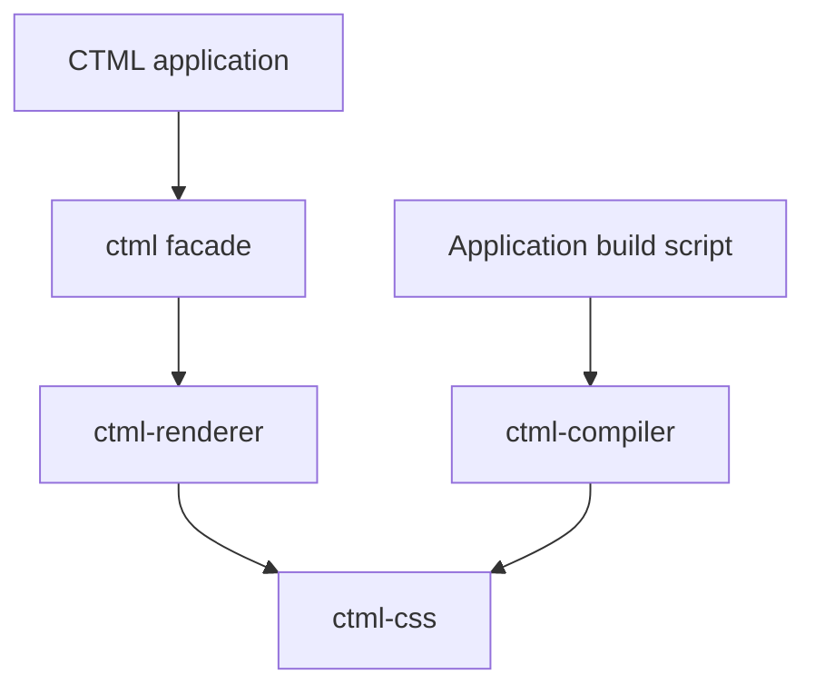

# Workspace Architecture

CTML is split into crates by responsibility. The public `ctml` package stays as a small facade so applications can keep a single runtime dependency.

| Crate | Responsibility |
| --- | --- |
| `ctml` | Stable public entry point; reexports window, node, and stylesheet types. |
| `ctml-renderer` | Native window lifecycle, text layout, style application, rasterization, selection, and cursor behavior. |
| `ctml-css` | Stylesheet parsing, selector matching and specificity, CSS color parsing, and length parsing. |
| `ctml-compiler` | CTML tokenization and markup parsing; reexports stylesheet parser types for compatibility. |

`ctml-css` owns syntax and selector utilities. `ctml-renderer` currently owns computed text styles because those values are coupled to the renderer's font and text APIs. Layout and painting beyond the current text-focused renderer will be added behind this crate boundary.

The workspace has no `ctml-compiler` executable. Applications invoke its library from a build script to parse `.ctml` documents; the CSS parser is available directly from `ctml-css` and through the compiler's compatibility reexports.
